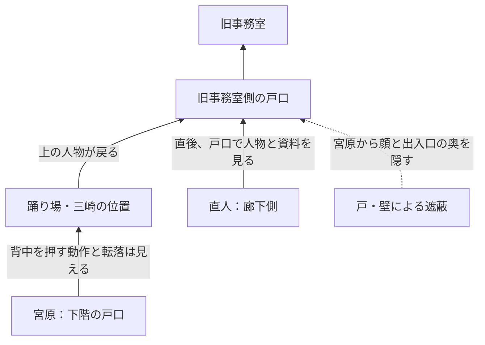

# 背景制作：基本構図と時間帯の台帳
2026-10-12。現行ver0.02と組込側の依頼を照合。必要数ずつ制作し、未確定の時間帯差分を先に増やさない。
参照元：C:/Users/lemon/Documents/Codex/2026-10-11/saeki-scenario-integration/outputs の背景・時間帯一覧、背景制作依頼準備、改訂稿ver0.02。
これらの準備資料にある「未依頼」より、今回受領した制作依頼を優先。原稿・実装の場所時刻の修正は組込側が担当する。

## 今回の第1組

| BG ID | 素材ID・候補 | 視点・時間帯 | 状態 |
|---|---|---|---|
| BG-01 | [office-interior-day](drafts/office-interior-day-01.png) | 既存室内と同じ視点。朝・昼共用候補 | 確認待ち |
| BG-02 | [office-exterior-day](drafts/office-exterior-day-01.png) | 道路反対側から浅い斜め。朝・昼共用候補 | 建築・構図の仮案、確認待ち |

室内は旧office-afternoonを編集し、左の書棚・机・ソファ、中央窓、右の書類棚・入口を維持。昼光色へ調整したが窓越しの影はある。季節・方角・日時を精密に固定した光ではなく、朝昼共用の候補。
建物前は新規の架空建築案。窓の茶色い枠とブラインド・手入れした古さを室内へ合わせたが、階数・事務所の所在階・建物の正式な形は未採用。入口横の名称は必ず佐伯探偵事務所。小さな看板の判読は組み込みサイズでも再確認する。
建物の空間連続性は窓素材・入口導線の候補照合まで。室内入口と外観玄関を同一扉と確定しない。共用階段の通過背景を新しく必須にしない。

[静的表示確認](ui-review-01.png)：既存の湊・澪の腰上候補を未採用の見本位置で合成。澪と右コマンドは重なるため、本編側で複数人とコマンドの配置確認が必要。位置を新しく確定しない。
全候補1920×1080、不透過RGB、人物なし。生成・編集は組み込みimage_gen、書き出しは比率維持の寸法調整のみ。
[生成記録](../integration-batch-01-sources.json)、[寸法とSHA-256](../integration-batch-01-validation.json)。

## 必要構図と時間帯：継続制作

| ID | 基本構図 | 必要時間帯・扱い | 現在 |
|---|---|---|---|
| BG-01 | 事務所室内 | 朝昼共用候補、夕は同じ構図の光の差分 | 基本候補済み、夕は残作業 |
| BG-02 | 事務所建物前 | 朝昼共用候補、夕は光の差分 | 基本候補済み、夕は残作業 |
| BG-03 | 東成ビルサービス外観 | 昼のみ。入口を明示 | 次の基本構図 |
| BG-04 | 同受付 | 昼。調べる対象は受付 | 既存テスト候補の目視比較・新規案は残作業 |
| BG-05 | 同応接 | 昼。同室共用可否を判断 | 受付と同室なら1枚、別室なら移動描写に従う |
| BG-06 | 成子坂共同ビル外観・入口 | 朝昼は中立昼光の共用可否を検討、夕は光差分 | 既存テスト候補の建物連続性確認が残作業 |
| BG-07 | 管理人室 | 夕必須。朝昼は改稿連絡待ち | 基本構図と夕光を制作する範囲 |
| BG-08 | 階段・踊り場 | 昼必須。朝は改稿連絡待ち | 証言視点と遮蔽物の図を先に照合 |
| BG-09 | 旧事務室 | 朝必須。昼は誤表示疑いが解消するまで追加しない | 既存テスト候補の比較が残作業 |
| BG-10 | 西新宿警察署外観 | 昼想定、改稿で確定 | 基本構図候補、時間帯の正式採用は待ち |
| BG-11 | 同受付 | BG-10と同じ訪問時間帯 | 同上 |
| BG-12 | 同面会室 | 昼想定。終盤聴取の兼用は改稿に従う | 同上 |

朝と昼の室内は、同じ窓光で自然なら共用する。夕は色だけでなく窓光・照明・影の整合を見る。確定前に全場所×5時間帯の画像を作らない。
会社受付と応接は、同室の待合いに小さな面会卓を設ければ共用候補にできる。現在は共用未決。別室にする場合は扉・案内・移動を原稿と合わせる。
警察署は架空、名称は西新宿警察署。実在施設の所在・内部を再現しない。
兄妹アパート、宿、屋上、飲食店は現行で映す場面がなく制作対象外。夜・深夜も現行不要。
部間挿絵8接続箇所は指定表受領待ち。

## 階段：絵を描く前の証言視点整理
下記は非縮尺の関係図。寸法、階数、左右、窓位置は未採用。既存テスト候補を確認し、改稿側の現場図と照合してから画像にする。

宮原が顔を見ていない理由は、戸の陰と位置関係で成立させる。動作も顔も見えない絵、人物の顔まで見渡せる絵にしない。
直人が見た人物・資料と宮原が見た動作は、移動先・直後という時間関係でつなぐ。服の灰色だけで特定しない。
現場背景は人物を描かず、目撃位置の図・挿絵を別管理する。
